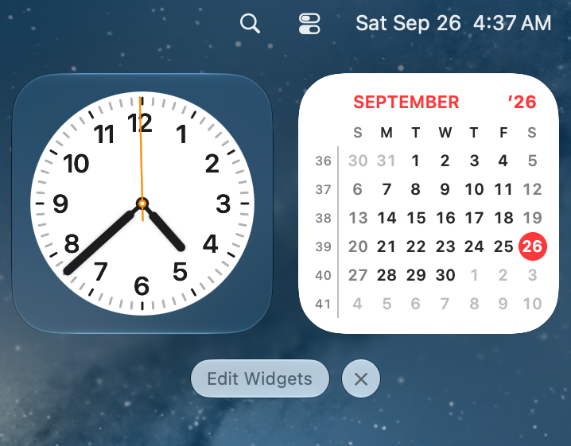

# Leap Widget

Leap Widget puts one or two months on your macOS Desktop or in Notification
Center, with week numbers if you want them and one click through to the calendar
you already use.

It shows dates, not events, so it needs no permissions. It never connects to the
network, needs no account, and is free and open source (MIT).

<p align="center">
  
</p>

## Install

Requires macOS 14 Sonoma or later.

```sh
brew install --cask antavik/apps/leap-widget
```

Prefer a regular download? Get the DMG from the
[latest release](https://github.com/antavik/Leap-widget/releases/latest), open it,
and drag `Leap Widget.app` into **Applications**. macOS asks once to confirm the
first launch, a step the Homebrew cask skips.

Either way, you get an app signed with a Developer ID and notarized by Apple. Open
Leap Widget once to register its widgets with macOS, then
[place your first widget](#get-started).

## What you get

**Two months, side by side.** A deadline on the 2nd stays visible during the last
week of this month. The Two Months widget pairs the current month with the next or
the previous one, and the smaller Month widget shows a single month: current,
previous, or next.

**Week numbers you can plan by.** If your team, school, or ERP plans in "W42", the
number is on your Desktop. Monday-first layouts number weeks by ISO 8601, choosing
Sunday uses the US rule, and other layouts on System Default use your region's rule.

**One click to your real calendar.** Each widget can open your default calendar
app, Fantastical, or Google Calendar in your browser. It can also do nothing at
all, so a stray click never pulls an app to the front.

**Nothing private on screen.** The widgets show no event titles, so you can leave
them in view while you present or share your screen.

**Nothing left to manage.** Close the setup window and the app quits. There is no
menu bar icon and no background helper. macOS runs the sandboxed widget itself
whenever it needs drawing.

**Follows your Mac, no setup.** Light and dark follow the system, including the faded
look Desktop widgets take on when another app is in front. Today's marker moves at
midnight, weekends use your region's weekend days, and month names come from your
Mac's language.

**Built for VoiceOver.** Each widget reads as one short summary, such as "Today is
Sunday, September 27, 2026", rather than as dozens of separate numbers.

### What it does not do

Leap Widget does not show events. If you want your meetings on the Desktop, this is
not the app for you. If you want to see the shape of the month and keep your
schedule to yourself.

## Every widget has its own settings

Place as many widgets as you like, and changing one never changes another. You can
keep a Monday-first planner on the Desktop and a Sunday-first month in Notification
Center at the same time, or set two small Month widgets to *Current* and *Next* and
arrange them yourself.

| Setting | Choices |
|---|---|
| **Second Month** (Two Months only) | Next or Previous |
| **Month** (Month only) | Current, Previous, or Next |
| **First Day of Week** | System Default, Monday, or Sunday |
| **Week Numbers** | On or off (off by default) |
| **Adjacent Month Days** | On or off (on by default) |
| **Show Year** | On or off (on by default), in short form such as ’26 |
| **Month Number** | Off, Number (6), or Roman (VI) |
| **Click Opens** | Default Calendar, Fantastical, Google Calendar, or Nothing |

<table>
  <tr>
    <td align="center">
      <br>
      Week numbers
    </td>
    <td align="center">
      <br>
      A Roman month number
    </td>
    <td align="center">
      <br>
      In Notification Center
    </td>
  </tr>
</table>

## Get started

1. **Open Leap Widget once.** The widgets will not appear in the widget gallery until
   you do. The window that opens lists what to do next.
2. **Place a widget.** Right-click the Desktop, choose **Edit Widgets…**, search for
   *Leap Widget*, and drag out **Two Months** or **Month**. For Notification Center,
   click the clock in the menu bar, scroll to the bottom, and choose **Edit
   Widgets**.
3. **Make it yours.** Right-click the placed widget and choose its **Edit** item.
   Changes take effect as you pick them.

The user manual covers every option and what it is good for, choose **Help ▸ Leap Widget
Manual** or press Command-?, and you can read and search it with no network
connection.

## Questions

**Is it really free?**
Yes. There is one download, and everything on this page is in it.

**Leap Widget is not in the widget gallery. What now?**
Open the app once, because that is what registers the widgets. If it still does not
appear, choose **Help ▸ Repair Widgets**, or log out and back in.

**What happens when I click a widget?**
The app launches just long enough to hand the click to your chosen calendar, and
then it quits. If the app you chose is not installed, the Calendar app opens
instead. With **Click Opens** set to Nothing, the app does not launch at all.

**Do my settings sync?**
No. Each widget's settings stay on the Mac where you placed it.

## Uninstalling

Open Leap Widget and choose **Help ▸ Uninstall Leap Widget…**. It moves itself and
its settings to the Trash and quits, and the widgets disappear on their own. If you
installed it with Homebrew, it hands the job to `brew` instead, so that Homebrew's
own records stay correct.

There is one catch, and it comes from macOS. `~/Library/Containers` is out of reach
of every app except Finder, so after a direct install a sandbox folder can stay
behind. The app names whatever it could not remove and offers to show it in Finder,
where dragging it to the Trash finishes the job.

<details>
<summary>Uninstalling from the Terminal</summary>

A Homebrew install comes out with:

```sh
brew uninstall --cask --zap leap-widget
```

Without `--zap`, the app goes but its settings stay. That is Homebrew's convention,
not Leap Widget's.

Dragging the app to the Trash also works, and it leaves a few megabytes behind. To
clear those out by hand:

```sh
rm -rf ~/Library/Preferences/com.antavik.leapwidget.plist \
       ~/Library/Containers/com.antavik.leapwidget \
       ~/Library/Containers/com.antavik.leapwidget.widget \
       "$HOME/Library/Application Scripts/com.antavik.leapwidget" \
       "$HOME/Library/Application Scripts/com.antavik.leapwidget.widget" \
       "$HOME/Library/Saved Application State/com.antavik.leapwidget.savedState" \
       ~/Library/Caches/com.antavik.leapwidget
```

The two `Containers` entries need Full Disk Access for whichever terminal runs this
(**System Settings ▸ Privacy & Security ▸ Full Disk Access**). Without it they refuse
to go, even with `sudo`. Finder removes them with no setup. The app itself is not
sandboxed, so its own two entries are normally absent and are listed only for
completeness.

</details>

See the manual's [uninstalling page](docs/manual/uninstalling.md) for the full
details.

## Feedback

Leap Widget is new, so reports are especially useful. You can
[open an issue](https://github.com/antavik/Leap-widget/issues), email
[antavik@pm.me](mailto:antavik@pm.me), or choose **Help ▸ Support & Feedback** in
the app. Please include your macOS version, the Leap Widget version, and what you
expected to happen.

If Leap Widget is useful to you, starring this repository helps other people find
it.

## For developers

[CONTRIBUTING.md](CONTRIBUTING.md) covers the build, the help book, the test layers,
and the project layout.

## License

Leap Widget is free to download and use, and its source code is released under the
[MIT License](LICENSE).

---

Leap Widget is an independent project. It is not affiliated with, or endorsed by,
Apple Inc., Flexibits, or Google. Mac and macOS are trademarks of Apple Inc.,
registered in the U.S. and other countries and regions. Other product names are
trademarks of their respective owners.
