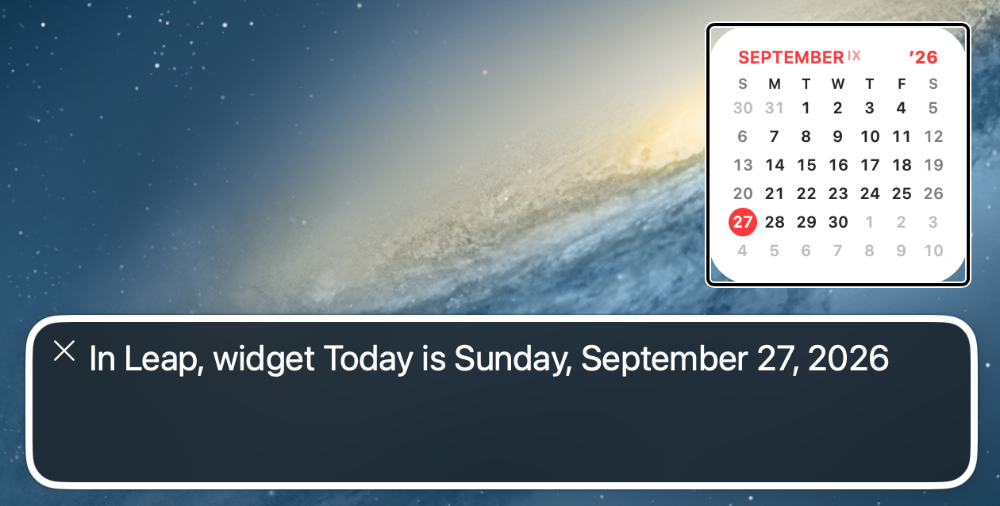

# Accessibility

Leap inherits the macOS accessibility settings you have already chosen. Nothing 
here needs to be turned on inside Leap.

## VoiceOver

A Leap widget speaks as a single element, not as forty-two separate day
numbers. VoiceOver reads a short, useful summary:

- The month that contains today: *"Today is Monday, 12 June 2026."*
- With **Week Numbers** on, the week is included: *"Today is Monday, 12 June
  2026, week 24."*

The date is formatted in your language and region.

To hear it: turn on VoiceOver (press Command-F5), then move the VoiceOver cursor
over the widget on the Desktop or in Notification Center.

<!-- SHOT: VoiceOver caption panel over the medium widget showing the spoken summary -->

The setup window is equally direct: each of the three steps is one VoiceOver
element, announced as *"Step 1 of 3"* with its full instruction, instead of an
icon and two separate blocks of text.

## Increase Contrast

With **System Settings ▸ Accessibility ▸ Display ▸ Increase contrast** turned
on, the superscript month number is drawn at full strength instead of the
dimmer default, keeping it legible against the wallpaper.

## Dark Mode and appearance

Leap follows **System Settings ▸ Appearance** automatically, including Auto. It
uses the system's own widget materials, so a Leap widget is as readable as
Apple's over the same wallpaper.

## Reduce Motion

Leap animates nothing. The widget changes only when the day does.

## Display size and zoom

Widget size is controlled by macOS, not by Leap: a widget is small or medium and
keeps its proportions. To make it larger on screen, use **System Settings ▸
Displays** to pick a scaled resolution, or Zoom under **Accessibility ▸ Zoom**.

## Keyboard

Widgets are placed and edited through the macOS widget gallery, which is
fully keyboard navigable (Tab, arrow keys, Space). Inside Leap's own window,
standard shortcuts apply — Command-W closes it, Command-Q quits, Command-? opens
this manual.

## Privacy, which is also accessibility

Leap shows no event titles. Nothing private is ever drawn on your Desktop, so a
Leap widget is safe to leave on screen while you present or screen-share.

Next: [Uninstalling Leap](uninstalling.md).
