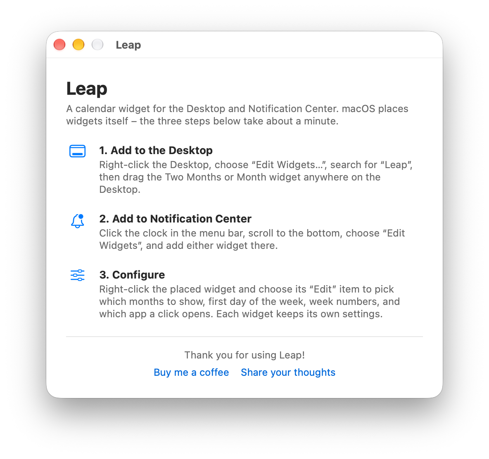
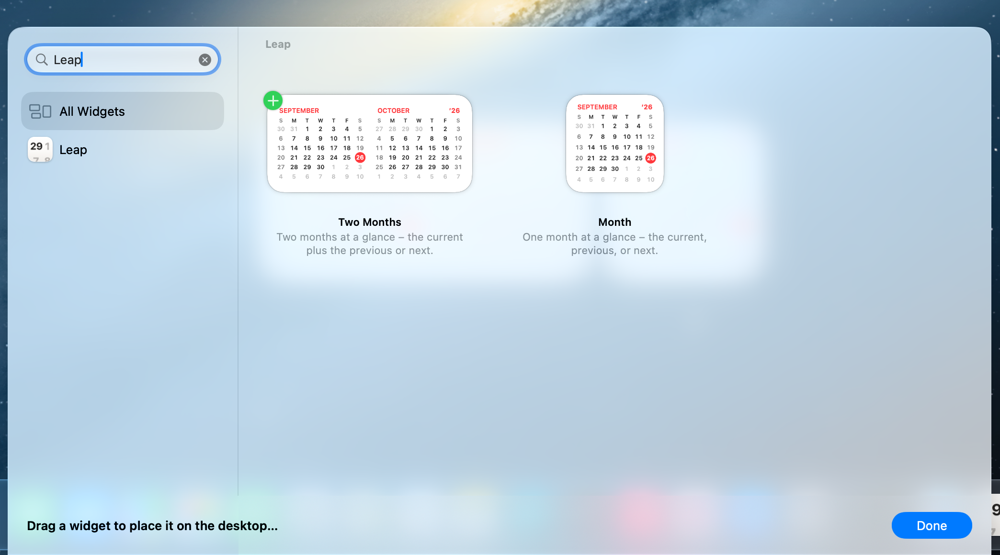
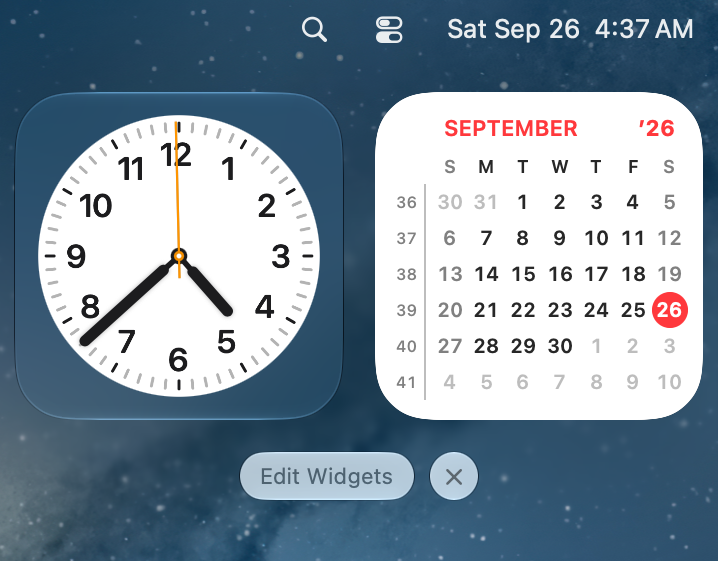

# Getting Started

## Install Leap

Leap is a regular application. Install it the way you got it:

- **Downloaded app** - drag `Leap.app` into your **Applications** folder.
- **Homebrew** - run `brew install --cask leap` in Terminal.

## Open Leap once

Open Leap from Applications, Launchpad, or Spotlight. This first launch is what
registers the widgets with macOS: until you do it, Leap does not appear in the
widget gallery.

The window that opens is a short guide to the same three steps described below.

<!-- SHOT: the app's main window, full height, light appearance -->

Leap does not run in the background and has no menu bar icon. Close the window
when you are done - macOS draws the widgets on its own. Open Leap again
whenever you want the guide, the manual, or the Help menu.

## Add a widget to the Desktop

1. Control-click (or right-click) an empty area of the Desktop.
2. Choose **Edit Widgets…**.
3. Type *Leap* in the search field, or find Leap in the list of apps.
4. Drag **Two Months** or **Month** onto the Desktop, or click it to place it.
5. Click **Done**.

<!-- SHOT: Edit Widgets gallery, "Leap" typed in search, both widget previews visible -->

Drag a placed widget to move it wherever you like. Desktop widgets fade into
the wallpaper while another app is in front - that is a macOS behavior, not a
Leap setting.

## Add a widget to Notification Center

1. Click the clock at the right of the menu bar to open Notification Center.
2. Scroll to the bottom and click **Edit Widgets**.
3. Find Leap, then click or drag the widget you want.
4. Click **Done**.

<!-- SHOT: Notification Center open with the Month widget in the stack -->

## Place more than one

You can place as many Leap widgets as you like, in either location, and each
one keeps its own settings. A common setup is a **Two Months** widget on the
Desktop for planning, plus a **Month** widget in Notification Center for a
quick check.

---

Previous: [Leap User Manual](index.md) · Next: [Configuring Widgets](widgets.md)
