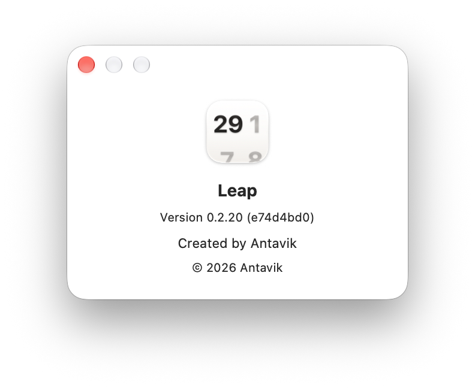

# Support and Feedback

## Email

Questions, bug reports, and feature ideas all go to one address:

**antavik@pm.me**

From inside the app, choose **Help ▸ Support & Feedback** — it opens a new mail
message with the subject already filled in.

When reporting a problem, these three lines make it much faster to fix:

1. Your macOS version (**Apple menu ▸ About This Mac**).
2. Leap's version (**Leap ▸ About Leap**).
3. What you did, what you expected, and what happened instead.

<!-- SHOT: standard About panel with version and build -->

## Support the project

Leap is free, has no ads, no account, and no tracking. If it earns a place on
your Desktop, you can buy me a coffee:

**<https://buymeacoffee.com/antavik>**

In the app: **Help ▸ Donate**, or the link at the bottom of the welcome window.

## Common questions

**Leap does not appear in the widget gallery.**
Open the app once — that is what registers the widgets. If it still does not
appear, log out and back in.

**Clicking the widget opens the wrong app.**
Check **Click Opens** in that widget's settings. **Default Calendar** follows
whichever app macOS has registered for `ical://`, which you can change in
Calendar's own settings.

**Does Leap show my events?**
No. Leap has no access to your calendar data, asks for no permissions, and never
connects to the network.

**Do my settings sync between Macs?**
No. Each widget's settings live on the Mac it was placed on.
