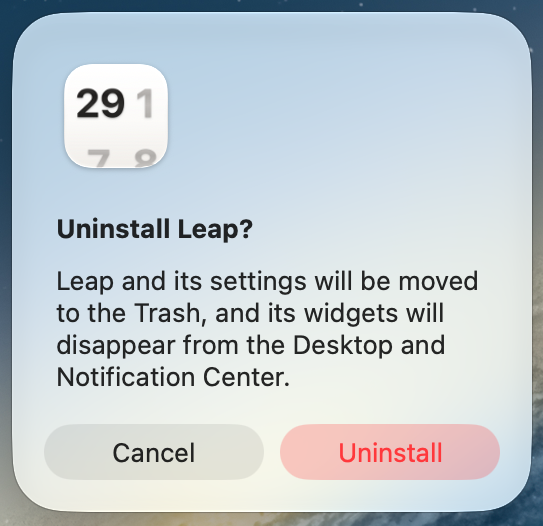
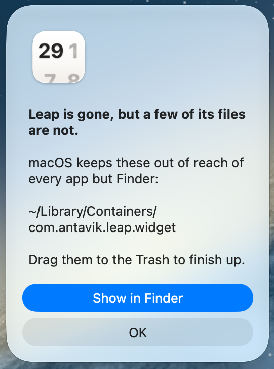

# Uninstalling Leap Widget

## The easy way

1. Open Leap Widget.
2. Choose **Help ▸ Uninstall Leap Widget…**.
3. Read the confirmation, then click **Uninstall**.


<!-- SHOT: the warning alert with Uninstall and Cancel buttons -->

Leap Widget moves itself and its settings to the Trash and quits. The widgets vanish
from the Desktop and Notification Center on their own, within a minute.

If you installed Leap Widget with Homebrew, it hands the job to `brew` instead, so
Homebrew's own records stay correct. You do not have to do anything
differently - Leap Widget works out how it was installed.

## The two folders macOS will not let Leap Widget delete

macOS keeps `~/Library/Containers` out of reach of every app except Finder, so
two sandbox folders survive the uninstall:

- `~/Library/Containers/com.antavik.leapwidget`
- `~/Library/Containers/com.antavik.leapwidget.widget`

Leap Widget lists them on the way out and offers **Show in Finder**. Drag them to the
Trash there and you are done. They hold a few megabytes and nothing personal.

Entering a password does not lift this restriction: it takes Full Disk Access,
which `sudo` cannot grant.


<!-- SHOT: the informational alert listing the two container paths -->

## From the Terminal

If you installed with Homebrew:

```sh
brew uninstall --cask --zap leap-widget
```

Without `--zap`, the app goes but its settings stay - that is Homebrew's
convention, not Leap Widget's.

For a downloaded copy, drag Leap Widget to the Trash, then clear the rest:

```sh
rm -rf ~/Library/Preferences/com.antavik.leapwidget.plist \
       ~/Library/Containers/com.antavik.leapwidget \
       ~/Library/Containers/com.antavik.leapwidget.widget \
       "$HOME/Library/Application Scripts/com.antavik.leapwidget" \
       "$HOME/Library/Application Scripts/com.antavik.leapwidget.widget" \
       "$HOME/Library/Saved Application State/com.antavik.leapwidget.savedState" \
       ~/Library/Caches/com.antavik.leapwidget
```

The two `Containers` entries need Full Disk Access for whichever terminal app
runs this (**System Settings ▸ Privacy & Security ▸ Full Disk Access**). Finder
removes them with no setup at all.

## Just dragging it to the Trash

That works too. It leaves a few megabytes of settings behind, which the
commands above clear out.

## A widget that stays behind

A widget whose app is gone shows an empty placeholder until macOS notices.
Control-click it and choose **Remove Widget** to be rid of it immediately.

---

Previous: [Accessibility](accessibility.md) · Next: [Support and Feedback](support.md)
