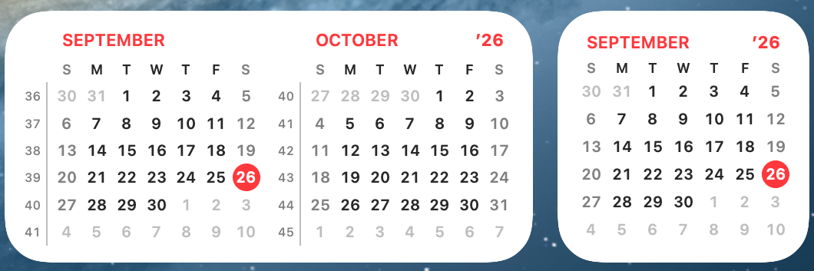
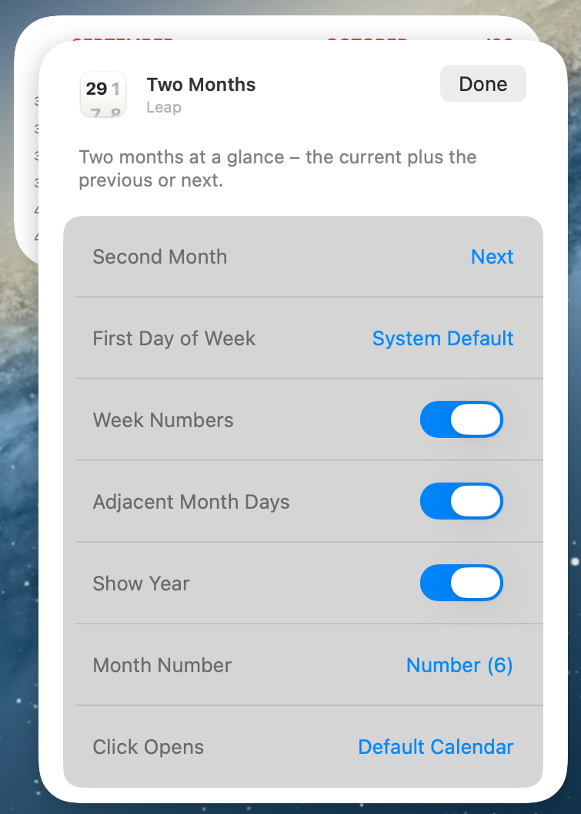
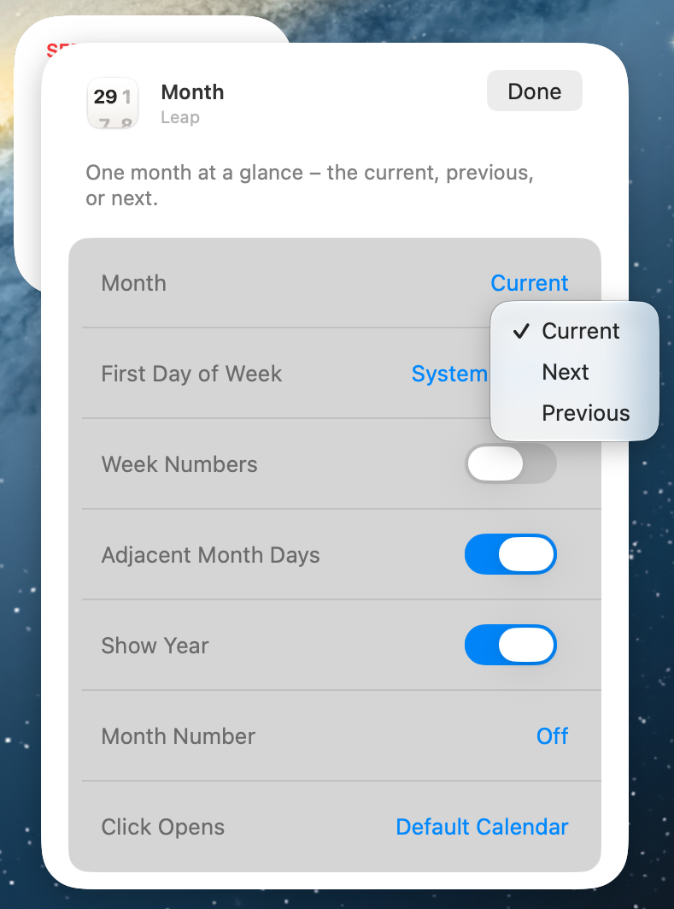
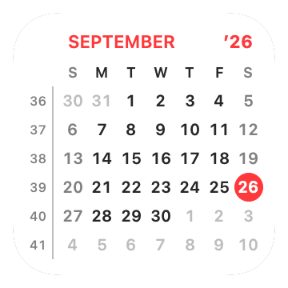
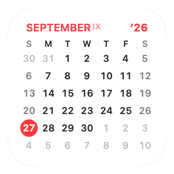

# Configuring Widgets

Every Leap widget carries its own settings. Changing one widget never changes
another, so you can keep a Monday-first planner on the Desktop and a
Sunday-first month in Notification Center at the same time.

## The two widget types

| Widget | Size | Shows |
|---|---|---|
| **Two Months** | Medium | The current month plus the previous *or* next month |
| **Month** | Small | A single month — current, previous, or next |

<!-- SHOT: medium and small widget, same settings, on a neutral background -->

**Two Months** suits planning across a month boundary — deadlines at the start of
next month stay visible in the last week of this one. **Month** suits a tight
spot on the Desktop or a crowded Notification Center.

## Open a widget's settings

1. Right-click (or Control-click) the placed widget.
2. Choose **Edit "Two Months"** or **Edit "Month"**.
3. Change the options. They apply as you pick them.
4. Click anywhere outside the widget to finish.

<!-- SHOT: right-click popover on the medium widget, every option row visible -->

If you do not see an **Edit** item, the widget is still showing its placeholder.
Open Leap once, then try again.

## The options

### Second Month (Two Months only)

Choose whether the companion month is **Next** or **Previous**. The current month
keeps its position in reading order: with *Next* it is on the left, with
*Previous* it is on the right.

*Why use it:* pick **Next** when you plan ahead, **Previous** when you reconcile
what already happened — timesheets, invoices, reviews.

### Month (Month widget only)

Choose which single month the widget shows: **Current**, **Previous**, or
**Next**.

*Why use it:* two small widgets side by side with *Current* and *Next* give you a
two-month view in a layout you arrange yourself.

<!-- SHOT: two small Month widgets side by side, one showing the current month and the other showing the next month -->

### First Day of Week

**System Default**, **Monday**, or **Sunday**.

*System Default* follows your Language & Region settings in System Settings.

*Why use it:* override it when your region and your working week disagree — an
ISO Monday-first grid for work, whatever your Mac's region says.

### Week Numbers

Off by default. When on, a narrow column of week numbers appears at the left of
each month, separated by a hairline rule.

Monday-first layouts number weeks by **ISO-8601**; other layouts use your
region's own rule, so the numbers match the rest of your Mac.

*Why use it:* essential if your team, school, or ERP plans in week numbers
("ship in W42").

<!-- SHOT: small widget, week numbers on, Monday-first -->

### Adjacent Month Days

On by default. The greyed-out days that fill the first and last rows belong to
the neighbouring months. Turn this off and those cells go blank.

*Why use it:* leave it on to see how a week straddles a month boundary; turn it
off for the cleanest possible grid.

### Show Current Year / Show Year

On by default. Shows the year in the top-right corner, in short form — `’26`.

*Why use it:* helpful in December and January, when the two months on show
belong to different years. Turn it off if you prefer a bare grid.

### Month Number

**Off**, **Number (6)**, or **Roman (VI)**. When on, the month's number appears as
a small superscript after the month name.

*Why use it:* many European and accounting conventions write dates as `12.VI` or
`12.6`. The superscript keeps that number in view without a second widget.

<!-- SHOT: close crop of the month title showing "JUNE VI" superscript -->

### Click Opens

What happens when you click the widget:

| Choice | Opens |
|---|---|
| **Default Calendar** | Your default calendar app, through `ical://` |
| **Fantastical** | Fantastical, through `x-fantastical3://` |
| **Google Calendar** | `calendar.google.com` in your default browser |
| **Nothing** | Nothing — the widget stays inert |

*Why use it:* one click from the month you are looking at to the app where you
edit it. Choose **Nothing** for a widget you only read, so a stray click never
pulls an app to the front.

If the chosen app is not installed, Leap falls back to Apple Calendar.

## What Leap does automatically

- **Today** is marked with a red circle, and rolls over at midnight.
- **Light and dark** follow the system appearance, including the faded look
  Desktop widgets take on when another app is in front.
- **Weekends** are drawn in a softer shade, using your region's weekend days.
- **Month names and weekday letters** come from your Mac's language.

None of these are settings — they track the system so the widget always matches
the rest of your Desktop.

Next: [Accessibility](accessibility.md).
